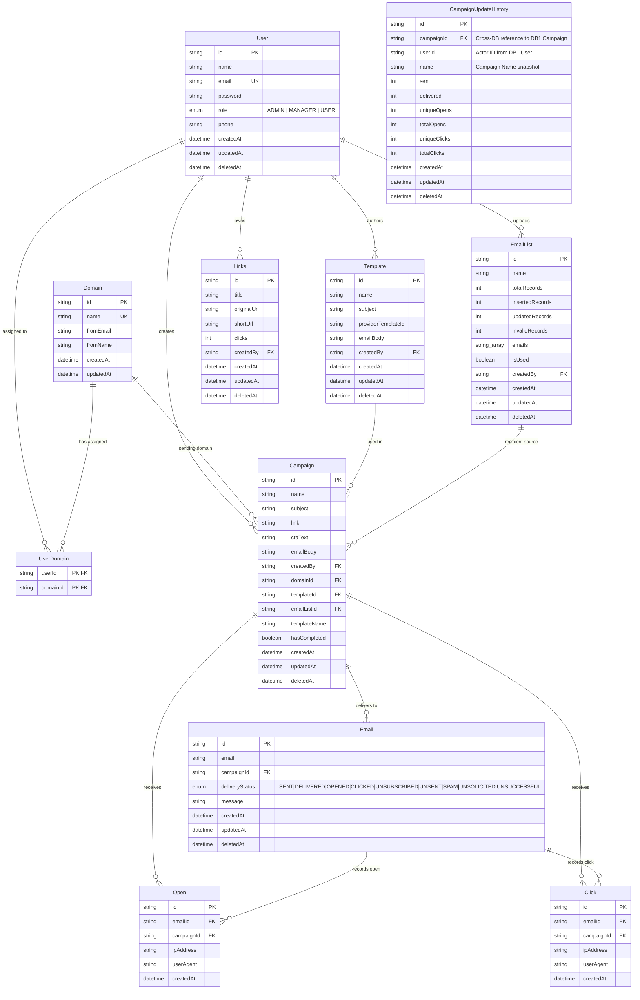
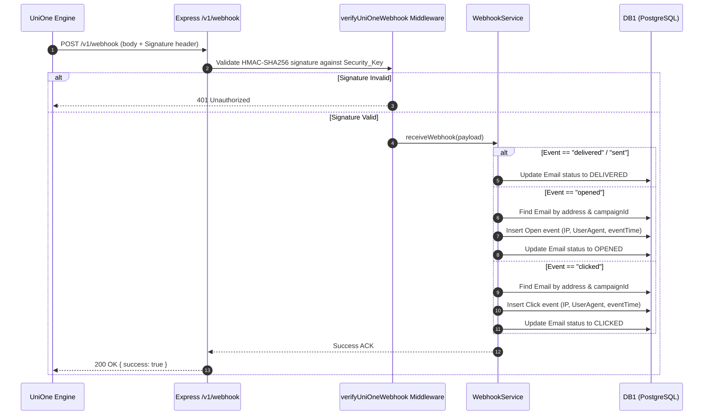
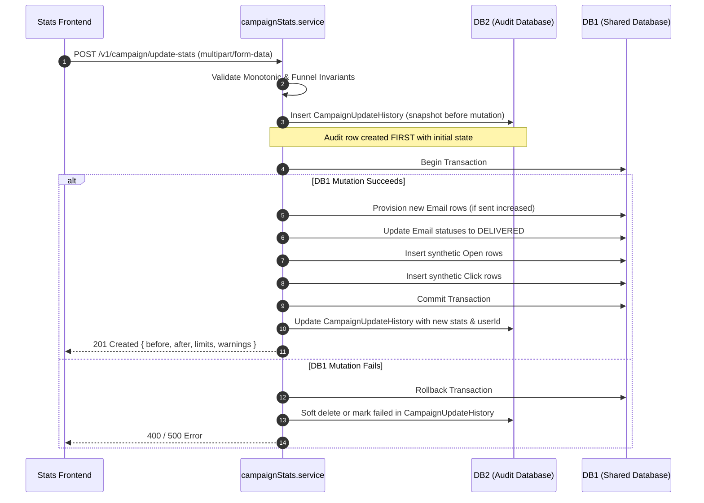

# Campaino Platform — System Architecture Document

## 1. Executive Summary & System Vision

**Campaino** is an enterprise email campaign management, execution, tracking, and analytics platform. The platform is designed to provide end-to-end management of marketing and transactional email campaigns, from template design and recipient list ingestion to outbound delivery via specialized email providers, real-time engagement telemetry (deliveries, opens, clicks), and manual funnel metrics injection with comprehensive audit logging.

The system is split into two specialized sub-systems across four distinct codebases:

```
+---------------------------------------------------------------------------------------------------+
|                                        CAMPAINO ECOSYSTEM                                         |
+---------------------------------------------------------------------------------------------------+
|  1. Core Email Campaign System                                                                     |
|     • Frontend: campaino-email-service-fe (React 19, Vite, Zustand, Tailwind v4, shadcn/ui)       |
|     • Backend:  campaino-selzy (Node.js 20+, Express 4, Prisma 7, PostgreSQL, UniOne Provider)    |
|                                                                                                   |
|  2. Stats Injection & Funnel Audit Microservice                                                   |
|     • Frontend: campaino-stater-service-fe (React 18, Vite, TanStack Table, Recharts, shadcn/ui)  |
|     • Backend:  campaino-stater-service-be (Node.js 20+, Express 4, Prisma 6, Dual PostgreSQL)    |
+---------------------------------------------------------------------------------------------------+
```

---

## 2. High-Level Architecture Topology

The following diagram illustrates the global architecture of the Campaino platform, including web applications, backend APIs, external providers, and database topology:

```mermaid
flowchart TB
    subgraph Clients["Web Clients & Users"]
        U_Browser["End User / Marketer Browser"]
        M_Browser["Campaign Manager Browser"]
        A_Browser["System Admin Browser"]
    end

    subgraph CoreFrontend["campaino-email-service-fe (:8080)"]
        FE1_Auth["Zustand Auth Store (JWT)"]
        FE1_Pages["Pages: Campaigns, Templates, Lists, Links, Admin"]
        FE1_Axios["Axios HTTP Client (Bearer Auth Interceptor)"]
    end

    subgraph StatsFrontend["campaino-stater-service-fe (:8081)"]
        FE2_Auth["Zustand Auth Store (JWT)"]
        FE2_Pages["Pages: Campaigns, Stats Manager, Audit History"]
        FE2_Axios["Axios Client (Rate-Limit & 403 Interceptors)"]
    end

    subgraph CoreBackend["campaino-selzy API (:3000)"]
        BE1_Auth["Passport JWT & RBAC Middleware"]
        BE1_Domain["Domain Scoping (UserDomain)"]
        BE1_Campaign["Campaign & Template Engine"]
        BE1_Links["Short Link & Redirection Service"]
        BE1_Webhook["Signed Webhook Ingestion Engine"]
        BE1_UniOne["UniOne Provider Client (Axios)"]
    end

    subgraph StatsBackend["campaino-stater-service-be (:4001)"]
        BE2_Auth["Passport JWT & Access Control"]
        BE2_Validation["Funnel & Monotonic Validator"]
        BE2_Provision["Email Provisioning Service (CSV/Upload Pool)"]
        BE2_Stats["Stats Injection Engine"]
    end

    subgraph ExternalServices["External Infrastructure"]
        UniOne["UniOne Email Delivery Platform"]
        Recipient["Recipient Mailbox / End Consumer"]
    end

    subgraph Storage["Data Persistence"]
        subgraph DB1_Cluster["DB1: Main Shared PostgreSQL (:5432)"]
            T_Users["User & UserDomain"]
            T_Domains["Domain"]
            T_Campaigns["Campaign"]
            T_Templates["Template"]
            T_EmailLists["EmailList"]
            T_Emails["Email (DeliveryStatus)"]
            T_Opens["Open (IP, UserAgent, Time)"]
            T_Clicks["Click (IP, UserAgent, Time)"]
            T_Links["Links (Shortened URLs)"]
        end

        subgraph DB2_Cluster["DB2: Audit PostgreSQL (:5432)"]
            T_Audit["CampaignUpdateHistory (Snapshots & Deltas)"]
        end
    end

    %% Client Interactions
    U_Browser & M_Browser & A_Browser -->|HTTPS| CoreFrontend
    M_Browser & A_Browser -->|HTTPS| StatsFrontend

    %% Core Frontend to Backend
    FE1_Pages --> FE1_Axios
    FE1_Axios -->|REST API :3000| CoreBackend

    %% Stats Frontend to Backend
    FE2_Pages --> FE2_Axios
    FE2_Axios -->|REST API :4001| StatsBackend

    %% Backend to External
    BE1_UniOne -->|POST /transactional/api/v1| UniOne
    UniOne -->|SMTP / Outbound Delivery| Recipient
    Recipient -->|Engagement Clicks & Opens| UniOne
    UniOne -->|POST /v1/webhook (HMAC Signed)| BE1_Webhook

    %% Backend to Databases
    CoreBackend -->|Prisma 7 Client| DB1_Cluster
    StatsBackend -->|Prisma 6 Client1 (Read/Write)| DB1_Cluster
    StatsBackend -->|Prisma 6 Client2 (Audit Write)| DB2_Cluster

    %% Short Link Traffic
    Recipient -->|GET /v1/link/:shortCode| BE1_Links
    BE1_Links -->|Redirect with 302 + UUID| Recipient
```

---

## 3. Subsystem Breakdown & Repository Boundaries

| Subsystem | Repository | Primary Stack | Responsibility & Scope | Target Audience |
|:---|:---|:---|:---|:---|
| **Core Campaign Frontend** | `campaino-email-service-fe` | React 19, Vite, TypeScript, Tailwind v4, shadcn/ui, Zustand | Primary marketing UI: campaign wizard, WYSIWYG template designer, Excel recipient list uploads, shortened link generator, domain/user management. | Admins, Managers, Standard Users |
| **Core Campaign Backend** | `campaino-selzy` | Node.js 20+, Express 4, TypeScript, Prisma 7, PostgreSQL | Central business logic: campaign lifecycle, template merge variable interpolation, UniOne outbound dispatch, signed webhook event ingest, link redirection, RBAC. | Consumed by `campaino-email-service-fe` & UniOne webhooks |
| **Stats Injection Backend** | `campaino-stater-service-be` | Node.js 20+, Express 4, TypeScript, Prisma 6, Dual PostgreSQL | Controlled stats simulation & funnel injection: adjusts `sent`, `delivered`, `uniqueOpens`, `totalOpens`, `uniqueClicks`, `totalClicks` in DB1, audits to DB2. | Consumed by `campaino-stater-service-fe` |
| **Stats Manager Frontend** | `campaino-stater-service-fe` | React 18, Vite, TypeScript, Tailwind v3, shadcn/ui, TanStack Table | Operational metrics UI: displays real-time campaign funnels, target-total updates with CSV upload support, audit log inspection. | Admins and Managers only |

---

## 4. Dual-Database Architecture & Data Models

A defining architectural trait of Campaino is its **dual-database design**:
1. **DB1 (Shared Main Database)**: Contains the single source of truth for all users, domains, campaigns, templates, recipient lists, email delivery statuses, opens, clicks, and links.
2. **DB2 (Audit Log Database)**: Dedicated exclusively to recording immutable audit trails (`CampaignUpdateHistory`) whenever campaign stats are adjusted via the stater service.

### 4.1. Entity-Relationship Diagram (DB1 & DB2)



### 4.2. Database Design & Coordination Rules

- **Schema Coordination**: Both `campaino-selzy` and `campaino-stater-service-be` share the same DB1 schema. `UserDomain` utilizes a composite primary key `@@id([userId, domainId])`.
- **Cross-Database Relationships**: There are **no physical database foreign keys** between DB1 and DB2. `CampaignUpdateHistory.campaignId` and `CampaignUpdateHistory.userId` are logical references to DB1 entities.
- **Migration Policy**:
  - `campaino-selzy` maintains migrations under `prisma/migrations` and supports `prisma migrate deploy`.
  - `campaino-stater-service-be` utilizes `prisma db push` across DB1 and DB2. `db:reset` is strictly forbidden on production DB1 to avoid data loss.

---

## 5. Authentication, RBAC & Multi-Tenant Domain Scoping

### 5.1. Unified Authentication Architecture

Both backend applications share the same cryptographic secret (`JWT_SECRET`) and authenticate against the common `User` table in DB1:

```
+-----------------------------------------------------------------------------------------+
|                                    SHARED JWT SYSTEM                                    |
+-----------------------------------------------------------------------------------------+
|  1. campaino-selzy issues token on POST /v1/auth/login                                  |
|  2. Token payload: { sub: user.id, email: user.email, role: user.role, exp: ... }        |
|  3. Both backends verify tokens using Passport JWT strategy & matching JWT_SECRET       |
|  4. campaino-stater-service-be accepts the same Bearer token without secondary login    |
+-----------------------------------------------------------------------------------------+
```

### 5.2. Role-Based Access Control (RBAC) Matrix

| Feature / Resource | ADMIN | MANAGER | USER |
|:---|:---:|:---:|:---:|
| **App Access: campaino-email-service-fe** | Full Access | Full Access | Read-Only Campaigns/Stats |
| **App Access: campaino-stater-service-fe** | Full Access | Domain-Scoped | **Forbidden (403)** |
| **Campaigns: List & View Stats** | All Campaigns | Own Domain Campaigns | Assigned Domain Campaigns |
| **Campaigns: Create, Run, Preview** | Allowed | Allowed (Own Domains) | Forbidden |
| **Templates: CRUD** | Full CRUD | Own Templates Only | Forbidden |
| **Email Lists: Upload & Delete** | Full Access | Own Lists Only | Forbidden |
| **Short Links: CRUD** | Full Access | Own Links Only | Forbidden |
| **Admin Panel: Domain CRUD** | Full Access | Forbidden | Forbidden |
| **Admin Panel: User Management & Domain Assignment** | Full Access | Forbidden | Forbidden |
| **Stats Microservice: Update Target Funnels** | Allowed (All) | Allowed (Own Domains) | Forbidden |
| **Stats Microservice: View Audit Logs** | All Records | Domain-Scoped Records | Forbidden |

### 5.3. Multi-Tenant Domain Scoping Mechanism

Domain scoping ensures strict tenant isolation for `MANAGER` and `USER` roles:
1. When a user registers or is created by an `ADMIN`, the admin assigns one or more `Domain` entities to the user via the `UserDomain` join table.
2. In `campaino-selzy`, every campaign requires a `domainId`.
3. In `campaino-stater-service-be`, domain access is enforced at the service layer:
   ```typescript
   // Evaluates whether the user has authorization to view or mutate the target campaign
   export const assertCampaignAccess = async (user: Pick<User, "id" | "role">, campaignId: string) => {
     if (isAdmin(user)) return;
     const assignedDomains = await getAssignedDomainIds(user.id);
     const campaign = await prisma.campaign.findFirst({
       where: { id: campaignId, domainId: { in: assignedDomains }, deletedAt: null }
     });
     if (!campaign) throw new ApiError(httpStatus.FORBIDDEN, "Access denied to campaign");
   };
   ```
4. Campaigns with `domainId = null` represent legacy unassigned campaigns and are visible strictly to `ADMIN` users.

---

## 6. External Integrations Architecture

### 6.1. UniOne Transactional Email Delivery

Outbound campaign execution relies on the UniOne API:
- **Template Synchronization**: When templates are created in Campaino, they are synced with UniOne via `POST /template/set.json`.
- **Campaign Execution (`POST /v1/campaign/run`)**:
  1. The campaign's email list is fetched.
  2. The email template HTML is merged locally with merge fields: `{{emailBody}}`, `{{link}}`, and `{{ctaText}}`.
  3. Recipients are partitioned into batches of 500 (`BATCH_SIZE = 500`).
  4. Each batch is dispatched to UniOne's `POST /email/subscribe.json` endpoint with `track_links: 1`, `track_read: 1`, and `global_metadata: { campaign_id }`.
  5. For each recipient, an `Email` record with status `SENT` is created in DB1.

### 6.2. Signed Webhook Event Ingestion Pipeline

Delivery, open, and click notifications are received from UniOne via webhooks at `POST /v1/webhook/`:



---

## 7. Stats Injection Engine & Mathematical Funnel Architecture

`campaino-stater-service-be` provides a specialized simulation engine capable of backfilling or adjusting campaign metrics in DB1 for auditing, reporting, or performance benchmarking.

### 7.1. Strict Funnel Hierarchy & Constraints

All metrics must satisfy strict monotonic and funnel consistency rules:

$$\text{sent} \ge \text{delivered} \ge \text{uniqueOpens} \ge \text{uniqueClicks}$$
$$\text{totalOpens} \ge \text{uniqueOpens}$$
$$\text{totalClicks} \ge \text{uniqueClicks}$$

```
+--------------------------------------------------------------------------------+
|                         THE CAMPAIGN FUNNEL PIPELINE                           |
+--------------------------------------------------------------------------------+
|                                                                                |
|  [ SENT ]  ================================================>  Target Sent       |
|      |                                                                         |
|      v  (Pool: deliverableSent)                                                |
|  [ DELIVERED ]  ===========================================>  Target Delivered  |
|      |                                                                         |
|      v  (Pool: openableDelivered)                                              |
|  [ UNIQUE OPENS ]  ========================================>  Target U-Opens   |
|      |        \                                                                |
|      |         +--> (Pool: repeatableOpens)  ==============>  Target Tot-Opens |
|      v                                                                         |
|  (Pool: clickableOpened)                                                       |
|  [ UNIQUE CLICKS ] ========================================>  Target U-Clicks  |
|               \                                                                |
|                +--> (Pool: repeatableClicks) ==============>  Target Tot-Clicks|
+--------------------------------------------------------------------------------+
```

### 7.2. Recipient Pool Provisioning

When a target `sent` exceeds current `sent`:
1. The service calculates the delta: $\Delta\text{sent} = \text{targetSent} - \text{currentSent}$.
2. If a file (`.csv` or `.txt`) is uploaded in the multipart request, emails are parsed and validated from the file (up to `MAX_UPLOAD_EMAILS = 50000`).
3. If no file is provided, emails are randomly selected from a pre-configured email pool (`CUSTOMERS_CSV_PATH`, e.g. `docs/customers-100000.csv`).
4. Emails are deduped against existing addresses already present in the campaign's `Email` records or the linked `EmailList`.
5. New `Email` records with `deliveryStatus: SENT` are inserted in DB1 in chunks of 1000.

### 7.3. Synthetic Event Generation & Two-Phase Transaction

To advance emails through the funnel:
- **Delivery**: Randomly selects `deliverableSent` emails (status `SENT`) and updates status to `DELIVERED`.
- **Unique Opens**: Randomly selects `openableDelivered` emails (status `DELIVERED`, zero existing `Open` records), inserts new `Open` records with randomized realistic User-Agents and IP addresses, and marks status `OPENED`.
- **Repeat Opens**: Randomly selects from already opened emails and appends additional `Open` rows.
- **Unique Clicks**: Randomly selects from opened emails with zero clicks, inserts new `Click` records, and updates status to `CLICKED`.
- **Repeat Clicks**: Appends additional `Click` records to previously clicked emails.

#### Dual-Database Best-Effort Atomic Transaction Flow



---

## 8. Link Shortener & Click Tracking Architecture

Campaino provides built-in link shortening and click attribution:
1. **Creation (`POST /v1/link/`)**: Generates a unique short code using `unique-string-generator` and stores the record in `Links` table with `clicks: 0`.
2. **Redirection (`GET /v1/link/:shortCode`)**:
   - Resolves the short code in DB1.
   - Atomically increments `Links.clicks` by 1.
   - Appends a unique tracking parameter: `originalUrl?uuid=<uuidv4>`.
   - Returns an HTTP redirect to the destination URL.

---

## 9. Infrastructure, Networking & Deployment Topology

### 9.1. Service Ports & Internal Routing

| Service Name | Container / Process | Default Dev Port | Preview / Prod Port | Primary Domain / Host |
|:---|:---|:---:|:---:|:---|
| `campaino-selzy` | `node-app` | `3000` | `3000` | `api.campaino.com` |
| `campaino-email-service-fe` | Vite SPA | `8080` | `8080` | `emails.campaino.com` |
| `campaino-stater-service-be` | `node-app` | `4001` (or `3001`) | `4001` | `api-stats.campaino.com` |
| `campaino-stater-service-fe` | Vite SPA | `8081` | `8080` | `statstracker.campaino.com` |
| PostgreSQL DB1 | `postgresdb` | `5432` | `5432` | Shared internal database network |
| PostgreSQL DB2 | `postgresdb-audit` | `5433` (or same instance) | `5432` | Audit database network |

### 9.2. Docker Topologies

Both backend services feature containerization:
- **`campaino-selzy/Dockerfile`**: Multi-stage Node.js build with Prisma client generation and PM2 / node runtime execution.
- **`campaino-stater-service-be/Dockerfile`**: Multi-stage Node.js build with dual Prisma schema generation (`client1` and `client2`).
- **Compose Files**:
  - `docker-compose.only-db-dev.yml`: Spins up local PostgreSQL instances for dev testing.
  - `docker-compose.yml`: Full container stack for backend plus database.
