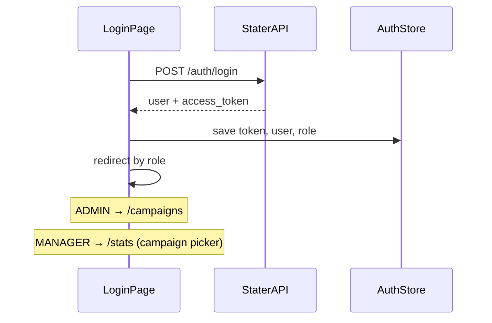
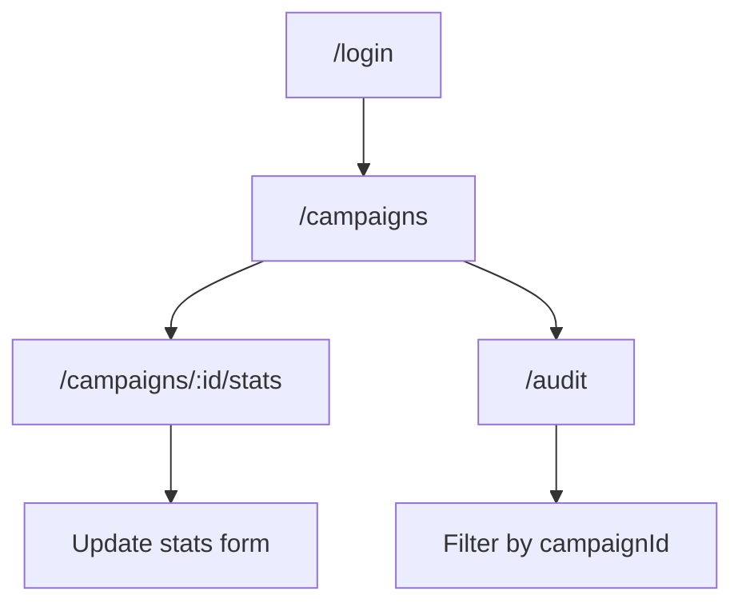

# Frontend Plan — Campaino Stats Manager

Plan for building a frontend that integrates with **campaino-stater-service-be**. This app is a **campaign stats manager** (not the full Selzy campaign platform). It lets ADMIN/MANAGER users view campaigns from the shared main backend DB and increase stats along the funnel: **sent → delivered → unique opens → total opens → unique clicks → total clicks**.

**API base URL:** `http://localhost:3001/v1` (configure via env)  
**Swagger UI:** `GET /v1/docs`  
**OpenAPI source:** `src/docs/paths/*.yml`, `src/docs/components.yml`

---

## 1. Product scope

### What the frontend does

| Feature | Who | Description |
|---------|-----|-------------|
| Login | ADMIN, MANAGER | JWT auth against shared User table |
| Campaign list | ADMIN, MANAGER | Search, sort, paginate campaigns (manager: assigned domains only) |
| Campaign stats view | ADMIN, MANAGER | Current funnel metrics + max allowed targets |
| Update stats | ADMIN, MANAGER | Set target totals; optional email file upload when increasing `sent` |
| Audit history | ADMIN, MANAGER | Paginated log (manager: assigned domains only) |

### What the frontend does NOT do

- Create/edit/send campaigns (main Campaino Selzy backend)
- Manage templates, email lists, domains, webhooks
- Decrease stats (API rejects targets below current)

### Relationship to main backend

- Campaigns are **read** from DB1 (same PostgreSQL as main backend).
- Stats changes **write** to DB1 (`Email`, `Open`, `Click`, `EmailList`) and audit to DB2.
- Users log in with credentials from the main backend (`admin@campaino.com`, `manager@campaino.com`, etc.).

---

## 2. Recommended stack

| Layer | Recommendation | Notes |
|-------|----------------|-------|
| Framework | React 18+ or Next.js 14+ (App Router) | Next.js if you want API proxy + SSR for login redirect |
| Language | TypeScript | Mirror backend types |
| HTTP | Axios or `fetch` + thin wrapper | Multipart for `update-stats` |
| Auth storage | `localStorage` or `sessionStorage` for `access_token` | Token expires in **1 hour** |
| UI | shadcn/ui + Tailwind | Forms, tables, toasts |
| Forms | React Hook Form + Zod | Client-side funnel validation before submit |
| Tables | TanStack Table | Campaign list + audit history |
| Charts (optional) | Recharts | Funnel bar / before-after comparison |

**Env vars (frontend):**

```bash
VITE_API_BASE_URL=http://localhost:3001/v1   # or NEXT_PUBLIC_API_BASE_URL
```

---

## 3. Role-based access (RBAC)

| Route / action | ADMIN | MANAGER | USER |
|----------------|-------|---------|------|
| Login | Yes | Yes | **No** (403 Forbidden) |
| `GET /campaign` | All campaigns | **Assigned domains only** | No |
| `GET /campaign/:id/current-stats` | Any campaign | **Assigned domains only** | No |
| `POST /campaign/update-stats` | Any campaign | **Assigned domains only** | No |
| `GET /campaign/updates` | Full audit log | **Assigned domains only** | No |

### Access rules

- **ADMIN** — full access to all campaigns and audit history.
- **MANAGER** — scoped via `UserDomain` → `Campaign.domainId`. Campaigns with no `domainId` or domains not assigned to the manager return **403 Forbidden**.
- **USER** — cannot log in; no API access.

Domain assignments come from the shared main backend DB (`UserDomain` table). Managers with **zero** assigned domains see empty campaign/audit lists.

**Frontend guards:**

```typescript
type Role = "ADMIN" | "MANAGER" | "USER"

const canAccessApp = (role: Role) => role === "ADMIN" || role === "MANAGER"
const hasFullAccess = (role: Role) => role === "ADMIN"
// MANAGER: same routes as ADMIN, but API returns only domain-scoped data
```

Both ADMIN and MANAGER use the same pages (`/campaigns`, `/campaigns/:id/stats`, `/audit`). The backend filters data for managers automatically — no separate MANAGER UI flow required.

---

## 4. Authentication

### Login

```http
POST /v1/auth/login
Content-Type: application/json

{ "email": "admin@campaino.com", "password": "Password123!" }
```

**200 response:**

```json
{
  "user": {
    "id": "uuid",
    "email": "admin@campaino.com",
    "name": "Admin",
    "role": "ADMIN",
    "createdAt": "...",
    "updatedAt": "...",
    "access_token": "eyJhbG..."
  }
}
```

**Errors:**

| Code | When |
|------|------|
| 404 | User not found |
| 401 | Wrong password or role not ADMIN/MANAGER |

### Token usage

All protected routes:

```http
Authorization: Bearer <access_token>
```

JWT payload fields used by backend: `id`, `email`, `role`. Expiry: **1 hour**.

### Frontend auth flow



**Implementation checklist:**

1. Login page → call API → store `{ token, user }`.
2. Axios/fetch interceptor attaches `Authorization` header.
3. On **401** → clear storage → redirect to `/login`.
4. On **403** → toast "Forbidden" → stay on page.
5. Optional: decode JWT `exp` and refresh/login before expiry (no refresh endpoint in this API — re-login required).

---

## 5. API reference (frontend types)

### Shared types

```typescript
// types/api.ts

export type Role = "ADMIN" | "MANAGER" | "USER"

export interface ApiError {
  code: number
  message: string
}

export interface User {
  id: string
  email: string
  name: string
  role: Role
  createdAt: string
  updatedAt: string
  access_token?: string
}

export interface Campaign {
  id: string
  name: string
  subject: string
  link: string
  ctaText: string
  emailBody: string
  htmlBody: string       // API alias for emailBody
  domainId: string | null
  emailListId: string | null
  templateId: string
  templateName: string
  hasCompleted: boolean
  createdAt: string
  updatedAt: string
}

export interface CampaignStatsSnapshot {
  sent: number
  delivered: number
  uniqueOpens: number
  totalOpens: number
  uniqueClicks: number
  totalClicks: number
}

export interface CampaignStatsLimits {
  maxDelivered: number
  maxUniqueOpens: number
  maxTotalOpens: number | null
  maxUniqueClicks: number
  maxTotalClicks: number | null
}

export interface CampaignCurrentStats extends CampaignStatsSnapshot {
  campaignId: string
  name: string
  hasCompleted: boolean
  limits: CampaignStatsLimits
}

export interface StatsUpdateResponse {
  before: CampaignStatsSnapshot
  after: CampaignStatsSnapshot
  applied: CampaignStatsSnapshot
  emailSource: "default_csv" | "upload" | "none"
  warnings: string[]
}

export interface PaginatedResponse<T> {
  campaigns: T[]          // note: key is "campaigns" even for audit rows
  totalRecords: number
  totalPages: number
  currentPage: number
  pageLimit: number
}

export interface CampaignUpdateHistory {
  id: string
  campaignId: string
  name: string
  sent: number
  delivered: number
  totalOpens: number
  uniqueOpens: number
  totalClicks: number
  uniqueClicks: number
  userId: string | null
  createdAt: string
}
```

---

## 6. Endpoints — request / response details

### 6.1 List campaigns (ADMIN)

```http
GET /v1/campaign?page=1&limit=10&search=&sortBy=createdAt&sortDirection=desc
Authorization: Bearer <token>
```

| Query | Type | Default | Allowed `sortBy` |
|-------|------|---------|------------------|
| `page` | number | 1 | — |
| `limit` | number | 10 | — |
| `search` | string | — | name, subject, templateName, emailBody, link |
| `sortBy` | string | `createdAt` | `createdAt`, `updatedAt`, `name`, `subject`, `templateName` |
| `sortDirection` | string | `desc` | `asc`, `desc` |

**200:** `PaginatedResponse<Campaign>`

---

### 6.2 Current stats (ADMIN, MANAGER)

```http
GET /v1/campaign/{campaignId}/current-stats
Authorization: Bearer <token>
```

**200:** `CampaignCurrentStats`

Use `limits` to set **max** on number inputs and show helper text:

| Field | Max from API | Meaning |
|-------|--------------|---------|
| `delivered` | `limits.maxDelivered` | Cannot exceed sent |
| `uniqueOpens` | `limits.maxUniqueOpens` | Eligible delivered-without-open |
| `totalOpens` | no hard max* | Needs ≥1 opener for repeat opens |
| `uniqueClicks` | `limits.maxUniqueClicks` | Opened-but-not-clicked pool |
| `totalClicks` | no hard max* | Needs ≥1 clicker for repeat clicks |

\*Repeat events have no numeric cap but require at least one eligible email.

---

### 6.3 Update stats (ADMIN, MANAGER)

```http
POST /v1/campaign/update-stats
Authorization: Bearer <token>
Content-Type: multipart/form-data
```

| Field | Type | Required | Notes |
|-------|------|----------|-------|
| `campaignId` | string (UUID) | Yes | |
| `sent` | integer ≥ 0 | No* | Target **total**, not delta |
| `delivered` | integer ≥ 0 | No* | |
| `uniqueOpens` | integer ≥ 0 | No* | |
| `totalOpens` | integer ≥ 0 | No* | |
| `uniqueClicks` | integer ≥ 0 | No* | |
| `totalClicks` | integer ≥ 0 | No* | |
| `file` | File | No | `.csv` or `.txt`; used when increasing `sent` |

\*At least **one** target field required. Omitted fields = unchanged.

**201:** `StatsUpdateResponse`

**Client example (FormData):**

```typescript
async function updateStats(
  token: string,
  payload: {
    campaignId: string
    targets: Partial<CampaignStatsSnapshot>
    file?: File
  }
): Promise<StatsUpdateResponse> {
  const form = new FormData()
  form.append("campaignId", payload.campaignId)

  for (const [key, value] of Object.entries(payload.targets)) {
    if (value !== undefined && value !== null) {
      form.append(key, String(value))
    }
  }

  if (payload.file) {
    form.append("file", payload.file)
  }

  const res = await fetch(`${API_BASE}/campaign/update-stats`, {
    method: "POST",
    headers: { Authorization: `Bearer ${token}` },
    body: form,
  })

  if (!res.ok) {
    const err: ApiError = await res.json()
    throw err
  }

  return res.json()
}
```

**Important:** Do **not** set `Content-Type: multipart/form-data` manually — the browser sets the boundary.

---

### 6.4 Audit history (ADMIN)

```http
GET /v1/campaign/updates?page=1&limit=10&campaignId=<uuid>&search=&sortBy=createdAt&sortDirection=desc
Authorization: Bearer <token>
```

| Query | Allowed `sortBy` |
|-------|------------------|
| optional `campaignId` | filter by campaign |
| `sortBy` | `createdAt`, `updatedAt`, `sent`, `delivered`, `totalOpens`, `uniqueOpens`, `totalClicks`, `uniqueClicks` |

**200:** `PaginatedResponse<CampaignUpdateHistory>`

---

## 7. Client-side validation (mirror backend)

Validate **before** submit to reduce 400 errors. Backend rules:

### Monotonic increase

Every provided target must be ≥ current value for that field.

### Funnel hierarchy

```
sent ≥ delivered ≥ uniqueOpens ≥ uniqueClicks
totalOpens ≥ uniqueOpens
totalClicks ≥ uniqueClicks
```

### Zod schema example

```typescript
import { z } from "zod"

export function buildStatsFormSchema(current: CampaignStatsSnapshot) {
  return z
    .object({
      sent: z.number().int().min(current.sent).optional(),
      delivered: z.number().int().min(current.delivered).optional(),
      uniqueOpens: z.number().int().min(current.uniqueOpens).optional(),
      totalOpens: z.number().int().min(current.totalOpens).optional(),
      uniqueClicks: z.number().int().min(current.uniqueClicks).optional(),
      totalClicks: z.number().int().min(current.totalClicks).optional(),
    })
    .refine(
      (v) =>
        Object.values(v).some((x) => x !== undefined),
      { message: "Change at least one stat" }
    )
    .superRefine((v, ctx) => {
      const resolved = {
        sent: v.sent ?? current.sent,
        delivered: v.delivered ?? current.delivered,
        uniqueOpens: v.uniqueOpens ?? current.uniqueOpens,
        totalOpens: v.totalOpens ?? current.totalOpens,
        uniqueClicks: v.uniqueClicks ?? current.uniqueClicks,
        totalClicks: v.totalClicks ?? current.totalClicks,
      }

      const rules: [boolean, string][] = [
        [resolved.sent >= resolved.delivered, "Sent must be ≥ delivered"],
        [resolved.delivered >= resolved.uniqueOpens, "Delivered must be ≥ unique opens"],
        [resolved.uniqueOpens >= resolved.uniqueClicks, "Unique opens must be ≥ unique clicks"],
        [resolved.totalOpens >= resolved.uniqueOpens, "Total opens must be ≥ unique opens"],
        [resolved.totalClicks >= resolved.uniqueClicks, "Total clicks must be ≥ unique clicks"],
      ]

      for (const [ok, msg] of rules) {
        if (!ok) ctx.addIssue({ code: "custom", message: msg })
      }
    })
}
```

### When increasing `sent`

| UI behaviour | Reason |
|--------------|--------|
| Show file upload (optional) | Custom recipients vs default CSV pool |
| Show `deltaSent = targetSent - currentSent` | User understands how many emails added |
| If `deltaSent > 0` and no file | Info: "Random emails from default pool" |
| Accept `.csv` (Email column) or `.txt` | Backend file rules |
| Max file size 10 MB | Backend multer limit |

If campaign has **zero** sent emails, user **must** provide a `sent` target (backend returns 400 otherwise).

---

## 8. Page structure & routes



| Route | Role | Purpose |
|-------|------|---------|
| `/login` | public | Email + password (ADMIN + MANAGER only) |
| `/campaigns` | ADMIN, MANAGER | Table scoped by role (all vs assigned domains) |
| `/campaigns/:campaignId/stats` | ADMIN, MANAGER | Stats dashboard + update form |
| `/audit` | ADMIN, MANAGER | Update history scoped by role |

**MANAGER flow:** Same as ADMIN — campaign list is filtered server-side to assigned domains only.

---

## 9. Screen specifications

### 9.1 Login

- Fields: email, password
- Submit → `POST /auth/login`
- Error messages from `ApiError.message`
- Store `user.access_token` and `user.role`

### 9.2 Campaign list (ADMIN + MANAGER)

- Fetch on mount + on search/sort/page change
- ADMIN sees all campaigns; MANAGER sees only campaigns whose `domainId` is in their `UserDomain` assignments
- Empty state for managers with no domains: "No campaigns in your assigned domains"
- Columns: Name, Subject, Template, Completed badge, Created, **Actions → View stats**
- Debounced search (300ms)
- Pagination controls bound to `totalPages`, `currentPage`

### 9.3 Stats dashboard + update form

**Layout (two columns on desktop):**

**Left — Current funnel (read-only cards):**

| Card | Value | Subtext |
|------|-------|---------|
| Sent | `sent` | |
| Delivered | `delivered` | `X% of sent` |
| Unique opens | `uniqueOpens` | |
| Total opens | `totalOpens` | |
| Unique clicks | `uniqueClicks` | |
| Total clicks | `totalClicks` | |

Optional: simple funnel chart (sent → delivered → opens → clicks).

**Right — Set target totals (form):**

- Six number inputs pre-filled with **current** values
- Each input: `min={current}`, `max={limits.max*}` where applicable
- Live validation via Zod as user types
- **Email file** section visible when `targetSent > currentSent`
- Submit → confirmation modal showing **deltas** (computed client-side)
- On success: show `before` / `after` / `applied` + `warnings` toast list

**Confirmation modal example:**

```
You are about to apply:
  +90 sent, +45 delivered, +8 unique opens, +12 total opens, ...
Email source: default_csv
[Cancel] [Confirm]
```

### 9.4 Audit history (ADMIN + MANAGER)

- Same table for both roles; MANAGER sees only updates for campaigns in assigned domains
- Filter by `campaignId` (dropdown from campaign list or UUID input)
- Sort by `createdAt` desc default

---

## 10. API client module structure

```
src/
  lib/
    api/
      client.ts       # base fetch, auth header, error parsing
      auth.ts         # login()
      campaigns.ts    # listCampaigns(), getCurrentStats(), updateStats()
      audit.ts        # listUpdates()
  hooks/
    useAuth.ts
    useCampaigns.ts
    useCampaignStats.ts
    useAuditHistory.ts
  types/
    api.ts            # interfaces above
```

**Base client pattern:**

```typescript
// lib/api/client.ts
export async function apiRequest<T>(
  path: string,
  options: RequestInit = {}
): Promise<T> {
  const token = localStorage.getItem("access_token")
  const headers = new Headers(options.headers)

  if (token) headers.set("Authorization", `Bearer ${token}`)
  if (!(options.body instanceof FormData)) {
    headers.set("Content-Type", "application/json")
  }

  const res = await fetch(`${import.meta.env.VITE_API_BASE_URL}${path}`, {
    ...options,
    headers,
  })

  if (!res.ok) {
    const err: ApiError = await res.json().catch(() => ({
      code: res.status,
      message: res.statusText,
    }))
    throw err
  }

  return res.json()
}
```

---

## 11. Error handling UX

| HTTP | Meaning | UI action |
|------|---------|-----------|
| 400 | Validation / funnel / insufficient emails | Show `message` on form; map to fields if possible |
| 401 | Token invalid/expired or login failed | Redirect login |
| 403 | Wrong role or campaign outside manager's domains | Toast + hide action / redirect |
| 404 | Campaign/user not found | Empty state or redirect |
| 500 | Server error | Generic toast + retry |

Display backend messages verbatim when helpful, e.g.:

- `"delivered target (5) cannot be less than current (8)"`
- `"Cannot add 50 delivered: only 12 eligible record(s) available"`
- `"Insufficient emails available: need 100, resolved 40"`

---

## 12. Implementation phases

### Phase 1 — Foundation (1–2 days)

- [ ] Vite/Next project + Tailwind + shadcn
- [ ] TypeScript types from section 5
- [ ] API client + auth interceptor
- [ ] Login page + protected route wrapper
- [ ] Role-based nav

### Phase 2 — Campaign list (1 day)

- [ ] ADMIN campaigns table with search/sort/pagination
- [ ] Link to stats page

### Phase 3 — Stats view & update (2–3 days)

- [ ] Fetch `current-stats` on campaign page load
- [ ] Funnel cards + limits-driven form
- [ ] Client Zod validation
- [ ] Multipart submit + confirmation modal
- [ ] Success state with before/after/applied/warnings

### Phase 4 — Audit (1 day)

- [ ] ADMIN audit table with campaign filter
- [ ] Pagination + sort

### Phase 5 — Polish (1 day)

- [ ] Loading skeletons, empty states
- [ ] Token expiry warning (55 min)
- [ ] Responsive layout
- [ ] Optional: OpenAPI-generated client from `/v1/docs` spec

---

## 13. Testing checklist

| Scenario | Expected |
|----------|----------|
| ADMIN login | Redirect to `/campaigns` (all campaigns) |
| MANAGER login | Redirect to `/campaigns` (domain-filtered list) |
| USER login | 403 from API |
| MANAGER opens campaign outside domain | 403 on stats/update |
| MANAGER with no UserDomain rows | Empty campaign list |
| Set delivered > sent | Client + server reject |
| Increase sent without file | Success; `emailSource: "default_csv"` |
| Increase sent with CSV | Success; `emailSource: "upload"` |
| Target below current | 400 with monotonic message |
| Expired token mid-session | 401 → login |
| Campaign with 0 emails | Must set `sent` first |

---

## 14. Seed credentials (dev)

| Email | Role | Password |
|-------|------|----------|
| admin@campaino.com | ADMIN | Password123! |
| manager@campaino.com | MANAGER | Password123! |

From main backend seed — same DB as stater service.

---

## 15. Related docs

- [FRONTEND_BE_UPDATES.md](./FRONTEND_BE_UPDATES.md) — **required frontend changes** after recent BE updates (start here if integrating)
- [CAMPAINO_SELZY_API_REFERENCE.md](./CAMPAINO_SELZY_API_REFERENCE.md) — main backend + this service overview
- Swagger UI at `/v1/docs` when server is running
- Main backend frontend guide (if exists): `docs/FRONTEND_INTEGRATION.md` on Selzy repo for campaign creation UI (separate app)

---

## 16. Open decisions for frontend team

1. **Separate vs embedded** — Standalone stats app vs iframe/tab inside main Campaino admin.
2. **Token refresh** — Re-login on expiry vs add refresh endpoint to stater API later.
3. **Real-time stats** — Poll `current-stats` after update vs rely on POST response only (response already includes `after`).
4. **Manager domain labels** — Optionally show `domain.fromEmail` on campaign rows (requires domain join endpoint or include in list response later).
